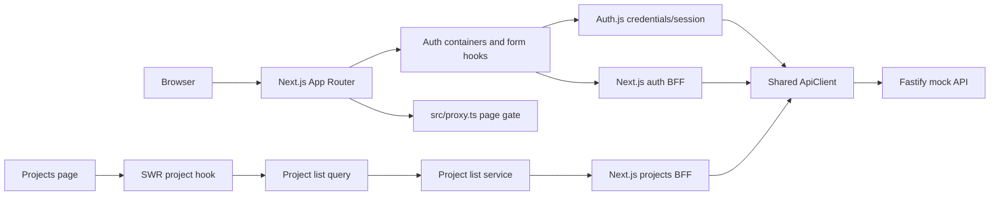
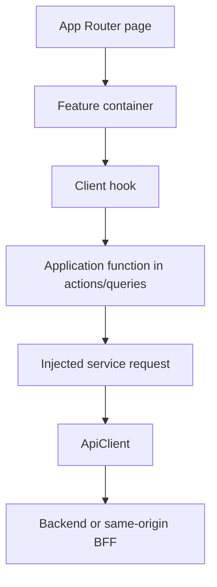

# Architecture and module boundaries

## Runtime shape

The diagram shows available paths, not a single request path. Sign-in goes through Auth.js and calls the backend from `src/auth.ts`; sign-up calls the same-origin BFF before signing in. See [authentication](authentication.md) for the exact flows.

## Source map

| Path                                          | Responsibility                                                                                                                                           |
| --------------------------------------------- | -------------------------------------------------------------------------------------------------------------------------------------------------------- |
| `src/app/`                                    | App Router pages, layouts, route handlers, global styles, and local fonts                                                                                |
| `src/dashboard/`                              | Static dashboard mock data, dashboard header sections, and a sign-out Server Action                                                                      |
| `src/projects/`                               | Project list types, backend service adapter, query use-case, SWR hook, and project list UI                                                               |
| `src/app/auth/`                               | Sign-in and sign-up route entry points                                                                                                                   |
| `src/app/api/auth/[...nextauth]/route.ts`     | Exposes Auth.js handlers                                                                                                                                 |
| `src/app/api/bff/auth/[...authPath]/route.ts` | Same-origin auth endpoints; this catch-all only allows auth operations                                                                                   |
| `src/app/api/bff/projects/route.ts`           | Authenticated same-origin proxy for the project list                                                                                                     |
| `src/auth.ts`                                 | Auth.js credentials provider, JWT/session callbacks, backend refresh and sign-out behavior                                                               |
| `src/auth/components/`                        | Auth-specific presentational form and branding components                                                                                                |
| `src/auth/containers/`                        | Composes auth layout, feature form hook, and presentational form                                                                                         |
| `src/auth/hooks/`                             | Client form state, validation wiring, submit orchestration, and navigation                                                                               |
| `src/auth/schemas/`                           | Zod schemas for auth form input                                                                                                                          |
| `src/auth/actions/`                           | Use-case factories that capture injected request functions and return actions typed only by their input and output; these are not Next.js Server Actions |
| `src/auth/services/`                          | Backend request adapters built on the shared `ApiClient`                                                                                                 |
| `src/auth/queries/`                           | Current-profile query mapping from `ApiResponse` to `Result`                                                                                             |
| `src/auth/store/`                             | A standalone auth store factory; no other `src` module currently imports it, so Auth.js is the active session authority                                  |
| `src/shared/services/`                        | Generic HTTP client and `ApiResponse` contract                                                                                                           |
| `src/shared/result/`                          | Discriminated `Result` contract and constructors                                                                                                         |
| `src/components/ui/`                          | Reusable UI primitives, grouped by component category; most components have a colocated Storybook story                                                  |
| `src/lib/`                                    | Small shared utilities and canonical route paths                                                                                                         |
| `mock-server/src/cases/`                      | Typed route inventories grouped by auth, users, and projects                                                                                             |
| `mock-server/src/index.ts`                    | Fastify server, API route registration, auth hook, and mock behavior                                                                                     |
| `mock-server/src/types.ts`                    | Mock-server record and output types                                                                                                                      |

## Feature request path

Use this as a boundary guide, not a requirement to add a layer to every small component. Keep UI rendering free of URL construction and raw `fetch` details. Keep request construction in services; use-case factories capture those dependencies and return actions whose types describe only their inputs and outputs.

## Result contracts

- HTTP boundaries return `ApiResponse<T>`: `{ data, error, ok, statusCode }`. `data`, `error`, and `statusCode` can be `null` depending on the outcome.
- Application queries/use cases can return `Result<T, E>`: either `{ success: true, data }` or `{ success: false, error }`.
- Do not confuse `ApiResponse.ok` with `Result.success`, or convert status codes into success unless the use case explicitly defines that mapping.

## Scope and current maturity

The app currently renders auth screens, a static dashboard header, and a projects list that starts from its supplied SWR fallback (currently empty on the projects page) and refreshes from the authenticated projects endpoint. Project switching and profile details in the header remain presentation-only mock data; sign-out uses the existing Auth.js session. Project, board, issue, sprint, task, label, member, and role models are present in the mock API; matching interactive frontend feature modules beyond project listing are not present yet. Before implementing one, trace the needed endpoint and define the UI/use-case/service types in the feature being added rather than assuming the mock API types are already suitable for browser code.
