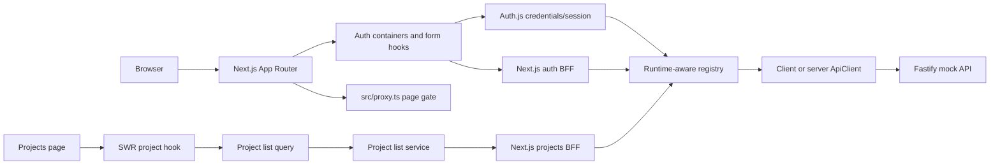
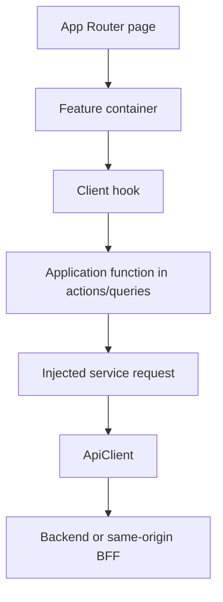

# Architecture and module boundaries

## Runtime shape



The diagram shows available paths, not a single request path. Sign-in goes through Auth.js and calls the backend from `src/auth.server.ts`; sign-up calls the same-origin BFF before signing in. Feature code lives in `src/modules/`; see the module rules below and [authentication](authentication.md) for the exact flows.

## Source map

| Path                                                       | Responsibility                                                                                                                  |
| ---------------------------------------------------------- | ------------------------------------------------------------------------------------------------------------------------------- |
| `src/app/`                                                 | Next.js App Router entry points, layouts, route handlers, global styles, and local fonts; keep pages thin                       |
| `src/app/actions/`                                         | Next.js Server Action adapters at the app integration boundary                                                                  |
| `src/modules/[module-name]/`                               | Feature modules; each owns its components, containers, hooks, schemas, types, use cases, queries, services, and feature data    |
| `src/modules/auth/`                                        | Auth UI and hooks, auth use cases and queries, schemas, types, request adapters, and public exports                             |
| `src/modules/projects/`                                    | Project list UI, hook, query, service, types, and public exports                                                                |
| `src/modules/dashboard/`                                   | Dashboard-owned display data and UI; its containers compose only dashboard features                                             |
| `src/modules/[module-name]/index.ts`                       | Public module API for symbols intended for use by other modules or app composition                                              |
| `src/modules/[module-name]/*/index.ts`                     | Public API of a module subfolder; external consumers use barrels instead of implementation paths                                |
| `src/components/`, `src/hooks/`, `src/lib/`, `src/shared/` | Cross-module UI, hooks, technical utilities, and generic application contracts                                                  |
| `src/app/auth/`                                            | Sign-in and sign-up route entry points                                                                                          |
| `src/app/api/auth/[...nextauth]/route.ts`                  | Exposes Auth.js handlers                                                                                                        |
| `src/app/api/bff/auth/[...authPath]/route.ts`              | Same-origin auth endpoints; this catch-all only allows auth operations                                                          |
| `src/app/api/bff/projects/route.ts`                        | Authenticated same-origin proxy for the project list                                                                            |
| `src/auth.server.ts`                                       | Auth.js credentials provider, JWT/session callbacks, backend refresh and sign-out behavior; imports auth through its public API |
| `src/containers/projects-page/`                            | Projects route composition across the dashboard and projects modules                                                            |
| `src/containers/`                                          | Multi-module page or section composition; feature-local composition stays inside its module                                     |
| `src/lib/api-client/`                                      | Shared transport core, client/server API-client entry points, `ApiResponse` contract, and response constructors                 |
| `src/lib/registry/`                                        | Typed registry builder, runtime selection, and global dependency composition                                                    |
| `src/utils/result/`                                        | Discriminated `Result` contract and constructors                                                                                |
| `src/components/ui/`                                       | Reusable UI primitives, grouped by component category; most components have a colocated Storybook story                         |
| `src/lib/`                                                 | Small shared utilities and canonical route paths                                                                                |
| `mock-server/src/cases/`                                   | Typed route inventories grouped by auth, logs, users, and projects                                                              |
| `mock-server/src/index.ts`                                 | Fastify server, API route registration, auth hook, and mock behavior                                                            |
| `mock-server/src/types.type.ts`                            | Mock-server record and output types                                                                                             |

## File and identifier naming (AI-first contract)

Apply these rules to every new or changed project-owned file and identifier. When refactoring existing code, update every import, export, test, Storybook reference, and configuration entry that points to a renamed file.

- Name React component implementation files in `PascalCase.tsx`; name their Storybook sidecars `PascalCase.stories.tsx`. Component declarations use PascalCase too.
- Name all other project-owned files in `kebab-case`. Next.js App Router reserved entry points keep the exact filenames required by the installed Next.js version (for example `page.tsx`, `layout.tsx`, `route.ts`, and `proxy.ts`). Keep `index.ts` barrels, package-configured executable entry points (such as `mock-server/src/index.ts`), generated `next-env.d.ts`, ecosystem-mandated config filenames, and conventional root guide names (`README.md`, `AGENTS.md`, `CLAUDE.md`) unchanged. Name project-owned declarations with the matching marker, such as `auth.type.d.ts` or `vitest-shims.type.d.ts`.
- Put one concern marker immediately before the extension: `*.type.ts` for types/interfaces, `*.schema.ts` for schemas, `*.factory.ts` only for files whose sole responsibility is defining/exporting factories and that contain no implementation, `*.server.ts` for server implementations, `*.client.ts` for client implementations, and `*.constants.ts` for files containing only constants. A file does not get the `.factory` marker just because it also exports a factory function; name it for its implementation role, such as `api-client.server.ts`.
- Use `PascalCase` for enum names and `SCREAMING_SNAKE_CASE` for enum member names and their string values, for example `enum AuthState { SIGNED_IN = "SIGNED_IN" }`.
- Prefix boolean variables and parameters with a predicate such as `is`, `has`, `can`, `should`, `did`, or `will` (`isLoading`, `hasSession`). Preserve names required by framework, DOM, third-party component APIs, and serialized/public wire contracts; adapt values at the boundary instead of renaming those external keys.
- End the names of action-oriented use cases (commands that change state or cause an operation) with `Action`, for both the variable and its type: for example, `createProjectAction: CreateProjectAction`. Do not use this suffix for read-only use cases that retrieve information, such as `getProject` or `GetProjectQuery`.
- Name functions whose purpose is handling an event or callback `handle...` (for example `handleSubmit`). Do not rename framework callback props such as `onClick` or domain operations that are not handlers.
- Name every custom React hook `use...`, including its file as `use-kebab-case.ts`.

Treat filename markers as semantic classification, not decoration: a `.server` implementation must not enter a client dependency graph, and `.client` code must not import server-only modules. A file may use only the marker matching its primary responsibility. A factory function that is part of an implementation does not change that file's primary role; use `.factory` only when the file contains factory definitions without an implementation. Split files when they combine unrelated responsibilities.

ESLint enforces the Prettier formatting contract through its recommended Prettier integration. Formatting violations are lint errors; run `npm run format` to apply formatting and `npm run lint` to verify it. Do not disable the Prettier ESLint rule for project files merely to silence a formatting error.

ESLint enforces the Prettier formatting contract through its recommended Prettier integration. Formatting violations are lint errors; run `npm run format` to apply formatting and `npm run lint` to verify it. Do not disable the Prettier ESLint rule for project files merely to silence a formatting error.

Before adding a new file, identify its role and apply the matching rule. If a Next.js reserved filename or external contract conflicts with a general rule, preserve the required external name and document/adapt the boundary.

## Module boundaries and imports

- Put feature-owned UI, custom hooks, use cases/actions, queries, services, schemas, types, data, and single-module containers under `src/modules/[module-name]/`.
- Keep generic or cross-module code under shared root areas such as `src/components/`, `src/hooks/`, `src/lib/`, and `src/shared/`. Keep Next.js route entry points under `src/app/`.
- Put reusable technical capabilities without feature-domain meaning in `src/lib/` (for example, logging or HTTP transport). Put generic application contracts and helpers shared across features in `src/shared/`. Feature-specific behavior stays with its owning feature.
- A module may import its own implementation directly. Cross-feature imports must use the other feature's root API or a subfolder public barrel; do not import another feature's implementation file. Imports inside the same feature remain unrestricted by this rule.
- The module root `src/modules/[module-name]/index.ts` is its public API. List every export explicitly; `export *` is prohibited in module root barrels. Subfolder barrels may group their own named exports.
- Modules may depend on shared code and another module's public API. Keep the module dependency graph acyclic. Shared libraries must not depend on feature modules. This rule does not prescribe internal import paths within a module or library.
- Keep runtime boundaries explicit: client code must not import server-only implementations or `server-only`; server-only implementations must not enter the client dependency graph. Pure type imports are acceptable only when the imported contract does not pull server runtime code into the client bundle. Next.js remains responsible for detecting transitive runtime violations.
- Use ESLint's fast architecture check (`npm run check:architecture`) to check module root exports, cross-feature implementation imports, and direct client-to-server imports. The check intentionally does not constrain imports within one feature or library.
- Put a container under `src/modules/[module-name]/containers/` when it composes only that module. Put it under `src/containers/` when it composes two or more modules. Route pages stay under `src/app/` and should delegate substantial composition to a suitable container.
- A UI container composes presentation and feature components by passing data and callbacks. Keep data fetching, HTTP details, and feature workflow in the appropriate hook, service, or use case.
- Use consistent folder naming, including `hooks/` (plural) and the established `components/`, `containers/`, `actions/`, `queries/`, `services/`, `schemas/`, and `types/` folders.

## Test placement

- Keep focused tests for one file or one small behavior with the code they verify: use a Storybook story (`*.stories.tsx`) for component examples and UI interaction tests, or a companion test file (`*.test.ts` / `*.test.tsx`) for unit tests.
- Put tests that exercise several parts of a feature module or a broader module workflow in that module's `__tests__/` directory. For example, use `src/modules/projects/__tests__/` for a flow that spans the projects hook, query, and request.
- Test files are development-only artifacts. Do not re-export them from a module's public `index.ts` barrel.
- Place tests for behavior spanning the whole application outside individual feature modules, in a clearly scoped integration or end-to-end test location.

## Registry and dependency-injection behavior

### Terminology

In project documentation and generated architecture prose, use **container** only for a React/UI composition component. A DI object is a **registry builder** before `build()` and a **built registry** after `build()`. Do not call a DI registry a container.

### Contracts for generated code

- The application has one central `baseRegistry` for dependencies shared across modules and a separate registry owned by each feature module. Register module-specific dependencies inside that module; register only genuinely shared dependencies in `baseRegistry`.
- A module's built registry may be used inside that module. Other modules and React/UI composition components may use it through the owning module's public `index.ts` barrel. Keep the module dependency graph acyclic.
- Export registries only after calling `.build()`. Export the built registry instance from the module's public barrel, not the `RegistryBuilder`.
- Use `.get(key)` as the default way to retrieve a dependency. Do not read `.instances` directly unless there is a concrete need to pass or inspect the full dependency set.
- Dependencies that must remain server-only for security or runtime reasons—such as secrets, private credentials, or direct database handles—must bypass the shared registry. Import and use them only from server-only code; never register them in a client/server registry provider.
- Every `.provide` call must declare both generic types explicitly: the literal key type first and the dependency type second. The key must be the lower-camel-case form of that dependency type. Apply the same explicit typing to `.provideForRuntime` registrations.

```ts
// Inside src/modules/projects/projects-registry.ts
export const projectsRegistry = createRegistry()
  .provide<"projectGetListRequest", ProjectGetListRequest>(
    "projectGetListRequest",
    () =>
      createProjectGetListRequest({
        apiClient: baseRegistry.get("apiClient"),
      }),
  )
  .provide<"projectGetListQuery", ProjectGetListQuery>(
    "projectGetListQuery",
    ({ projectGetListRequest }) =>
      createProjectGetListQuery({
        getProjectListRequest: projectGetListRequest,
      }),
  )
  .build();

// From a consumer outside the projects module, import via its public barrel.
const getProjectListQuery = projectsRegistry.get("projectGetListQuery");
```

The names in this example follow the rule `DependencyType` → `dependencyType`, and each provider states its output type in `.provide<Key, DependencyType>()`. Adapt the example to the actual dependency contract; do not copy a dependency key or type that the feature does not define.

### Builder behavior

`createRegistry()` returns an immutable builder. Providers are added explicitly and in dependency order:

- `provide(key, factory)` registers one implementation.
- `provideForRuntime(key, { client, server })` registers separate factories. `build()` detects the current runtime with `typeof window === "undefined"` and executes only that runtime's factory.
- `includeModule(factory)` registers the object returned by a module factory as a group of dependencies.

`build()` eagerly executes the registered steps in order. Each factory receives a shallow, read-only snapshot of dependencies registered by earlier steps; later registrations are unavailable to it. The built registry exposes the detected `runtime`, a frozen `instances` object, and `get(key)`. The registry does not discover providers, lazily resolve dependencies, or generate injection code. Registration and dependency order are explicit. Prefer `get(key)` over direct access to `instances`.

The client composition is a built `baseRegistry` in `src/lib/registry/client/registry-instance.client.ts`. Server composition is request-scoped: call `createServerRegistry()` from `src/lib/registry/server/registry-instance.server.ts` to build a fresh registry. Its `apiClient` dependency is a `ServerApiClient` factory; call it with the incoming request's cookie header to get an `ApiClient`. Never retain a server registry or a request-scoped API client in module-level state.

### Current module-registry migration gaps

- Server feature registries that depend on request cookies must be exported as registry factory functions. Each request calls the factory and uses the returned built registry; do not export one module-level registry instance for request-scoped dependencies.
- A server API client is a function from the incoming user's serialized Cookie header to an `ApiClient`. Call this function per request. If a request also needs bearer authentication, configure the request-scoped client with that access token without storing it in a shared registry.
- The auth injector/service still use an older registry-token API (`src/lib/registry/primitives`) and API-client paths that are absent from the current source tree. Treat that flow as migration residue, not as a working example of the current builder.

When adding DI code, use the current `RegistryBuilder` contract and public exports that actually exist. Keep construction explicit, preserve dependency order, use explicit generic types and type-derived camelCase keys, choose runtime-specific factories only for dependencies that are safe to expose in that registry, and build a module registry before exporting it. If migration changes these boundaries, update this section and the source-map table together.

## Feature request path



Use this as a boundary guide, not a requirement to add a layer to every small component. Keep UI rendering free of URL construction and raw `fetch` details. Keep request construction in services; use-case factories capture those dependencies and return actions whose types describe only their inputs and outputs.

## Result contracts

- HTTP boundaries return `ApiResponse<T>`: `{ data, error, ok, statusCode }`. `data`, `error`, and `statusCode` can be `null` depending on the outcome.
- Application queries/use cases can return `Result<T, E>`: either `{ success: true, data }` or `{ success: false, error }`.
- Do not confuse `ApiResponse.ok` with `Result.success`, or convert status codes into success unless the use case explicitly defines that mapping.

## Scope and current maturity

The app currently renders auth screens, a static dashboard header, and a projects list that starts from its supplied SWR fallback (currently empty on the projects page) and refreshes from the authenticated projects endpoint. Project switching and profile details in the header remain presentation-only mock data; sign-out uses the existing Auth.js session. Project, board, issue, sprint, task, label, member, and role models are present in the mock API; matching interactive frontend feature modules beyond project listing are not present yet. Before implementing one, trace the needed endpoint and define the UI/use-case/service types in the feature being added rather than assuming the mock API types are already suitable for browser code.
