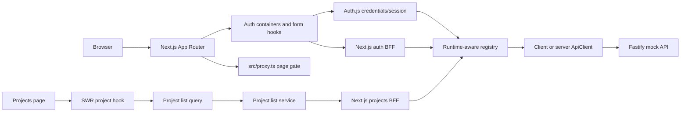
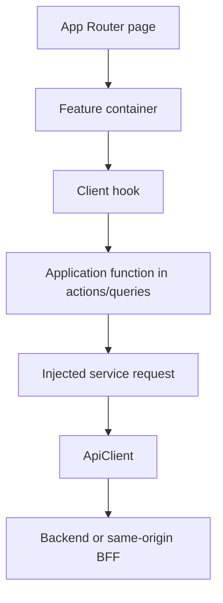

# Architecture and module boundaries

## Runtime shape

The diagram shows available paths, not a single request path. Sign-in goes through Auth.js and calls the backend from `src/auth.ts`; sign-up calls the same-origin BFF before signing in. Feature code lives in `src/modules/`; see the module rules below and [authentication](authentication.md) for the exact flows.

## Source map

| Path                                                       | Responsibility                                                                                                                  |
| ---------------------------------------------------------- | ------------------------------------------------------------------------------------------------------------------------------- |
| `src/app/`                                                 | Next.js App Router entry points, layouts, route handlers, global styles, and local fonts; keep pages thin                       |
| `src/app/actions/`                                         | Next.js Server Action adapters at the app integration boundary                                                                  |
| `src/modules/[module-name]/`                               | Feature modules; each owns its components, containers, hooks, schemas, types, use cases, queries, services, and feature data    |
| `src/modules/auth/`                                        | Auth UI and hooks, auth use cases and queries, schemas, types, request adapters, and public exports                             |
| `src/modules/projects/`                                    | Project list UI, hook, query, service, types, and public exports                                                                |
| `src/modules/dashboard/`                                   | Dashboard-owned display data and UI; its containers compose only dashboard features                                             |
| `src/modules/[module-name]/index.ts`                       | Public module API for symbols intended for use by other modules or app composition                                              |
| `src/modules/[module-name]/*/index.ts`                     | Public API of a module subfolder; external consumers use barrels instead of implementation paths                                |
| `src/components/`, `src/hooks/`, `src/lib/`, `src/shared/` | Cross-module UI, hooks, utilities, and generic contracts/services                                                               |
| `src/app/auth/`                                            | Sign-in and sign-up route entry points                                                                                          |
| `src/app/api/auth/[...nextauth]/route.ts`                  | Exposes Auth.js handlers                                                                                                        |
| `src/app/api/bff/auth/[...authPath]/route.ts`              | Same-origin auth endpoints; this catch-all only allows auth operations                                                          |
| `src/app/api/bff/projects/route.ts`                        | Authenticated same-origin proxy for the project list                                                                            |
| `src/auth.ts`                                              | Auth.js credentials provider, JWT/session callbacks, backend refresh and sign-out behavior; imports auth through its public API |
| `src/containers/projects-page/`                            | Projects route composition across the dashboard and projects modules                                                            |
| `src/containers/`                                          | Multi-module page or section composition; feature-local composition stays inside its module                                     |
| `src/lib/api-client/`                                      | Shared transport core, client/server API-client entry points, `ApiResponse` contract, and response constructors                 |
| `src/lib/registry/`                                        | Dependency-injection container and composition root; runtime-specific injectors register global and module dependencies         |
| `src/utils/result/`                                       | Discriminated `Result` contract and constructors                                                                                |
| `src/components/ui/`                                       | Reusable UI primitives, grouped by component category; most components have a colocated Storybook story                         |
| `src/lib/`                                                 | Small shared utilities and canonical route paths                                                                                |
| `mock-server/src/cases/`                                   | Typed route inventories grouped by auth, users, and projects                                                                    |
| `mock-server/src/index.ts`                                 | Fastify server, API route registration, auth hook, and mock behavior                                                            |
| `mock-server/src/types.ts`                                 | Mock-server record and output types                                                                                             |

## Module boundaries and imports

- Put feature-owned UI, custom hooks, use cases/actions, queries, services, schemas, types, data, and single-module containers under `src/modules/[module-name]/`.
- Keep generic or cross-module code under shared root areas such as `src/components/`, `src/hooks/`, `src/lib/`, and `src/shared/`. Keep Next.js route entry points under `src/app/`.
- Use `src/lib/registry/` as the dependency-injection container and composition root. `createRegistry()` collects providers without taking a runtime argument. During `build()`, the registry detects whether it is running on the client or server; `provideForRuntime(key, { client, server })` executes only the matching factory. Each dependency or feature owns its registration beside its implementation. This registration is explicit and does not generate injection code.
- A module may import its own implementation directly. Code outside a module must import only through its `src/modules/[module-name]/index.ts` or the appropriate subfolder `index.ts`; do not reach into another module's implementation files.
- Export every cross-boundary symbol from its owning subfolder barrel and the module root barrel. Keep implementation-only symbols private.
- Modules may depend on shared code and another module's public API. Keep the module dependency graph acyclic; move genuinely common contracts or logic to `src/shared/` instead of adding peer-to-peer implementation imports.
- Put a container under `src/modules/[module-name]/containers/` when it composes only that module. Put it under `src/containers/` when it composes two or more modules. Route pages stay under `src/app/` and should delegate substantial composition to a suitable container.
- Use consistent folder naming, including `hooks/` (plural) and the established `components/`, `containers/`, `actions/`, `queries/`, `services/`, `schemas/`, and `types/` folders.

## Feature request path

Use this as a boundary guide, not a requirement to add a layer to every small component. Keep UI rendering free of URL construction and raw `fetch` details. Keep request construction in services; use-case factories capture those dependencies and return actions whose types describe only their inputs and outputs.

## Result contracts

- HTTP boundaries return `ApiResponse<T>`: `{ data, error, ok, statusCode }`. `data`, `error`, and `statusCode` can be `null` depending on the outcome.
- Application queries/use cases can return `Result<T, E>`: either `{ success: true, data }` or `{ success: false, error }`.
- Do not confuse `ApiResponse.ok` with `Result.success`, or convert status codes into success unless the use case explicitly defines that mapping.

## Scope and current maturity

The app currently renders auth screens, a static dashboard header, and a projects list that starts from its supplied SWR fallback (currently empty on the projects page) and refreshes from the authenticated projects endpoint. Project switching and profile details in the header remain presentation-only mock data; sign-out uses the existing Auth.js session. Project, board, issue, sprint, task, label, member, and role models are present in the mock API; matching interactive frontend feature modules beyond project listing are not present yet. Before implementing one, trace the needed endpoint and define the UI/use-case/service types in the feature being added rather than assuming the mock API types are already suitable for browser code.
